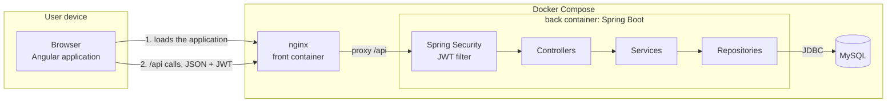

# Architecture

This document describes how the MDD code base is organised and the rules every change must follow.

## Overview



- The Angular application runs in the browser. nginx serves it and forwards every `/api` call to the back-end. In development, the Angular dev server plays the same role through `proxy.conf.json`.
- The back-end exposes a JSON REST API secured by JWT.
- MySQL stores the data. Flyway creates and evolves the schema.

## Tech stack

| Area | Tools |
| --- | --- |
| Front-end | Angular 20 (standalone components, esbuild builder), TypeScript 5.9, Angular CLI, RxJS, Signals, Tailwind CSS 4 |
| Back-end | Java 21, Spring Boot 3.5 (Web, Data JPA, Security, Validation), Lombok, Maven |
| Database | MySQL 8.4, Flyway |
| Security | JWT (Spring Security OAuth2 Resource Server), Argon2id password hashing |
| API documentation | springdoc-openapi (Swagger UI) |
| Tests | JUnit 5, Mockito, Spring Boot Test, Karma and Jasmine, Cypress |
| Code quality | ESLint with angular-eslint, Prettier, JaCoCo (back-end coverage), SonarQube for IDE (formerly SonarLint) in IntelliJ |
| Infrastructure | Docker, Docker Compose, nginx |
| CI and project management | GitHub Actions, GitHub Projects |
| API testing | Swagger UI, MockMvc and Testcontainers tests |

## Code map

### Back-end (`back/`)

```
src/main/java/com/openclassrooms/mddapi/
├── config/        cross-cutting configuration (OpenAPI)
├── controller/    REST controllers: HTTP layer, input validation, DTOs in and out
├── dto/           request and response objects exchanged with the front-end
├── exception/     business exceptions and the global error handler
├── mapper/        entity ↔ DTO conversion (MapStruct)
├── model/         JPA entities
├── repository/    Spring Data JPA repositories
├── security/      Spring Security configuration and JWT handling
└── service/       business rules: interfaces, implementations in service/impl/

src/main/resources/
├── application.properties
└── db/
    ├── migration/     Flyway migrations, all environments
    └── dev-data/      demo data, loaded with the dev profile only
```

A request goes through: JWT filter → controller → service → repository → MySQL.

### Front-end (`front/`)

```
src/app/
├── core/        app-wide services, HTTP interceptor, route guards, models
├── features/    one folder per feature: auth, feed, topics, posts, profile
└── shared/      reusable UI components, trim directive, form validators, loading state of the pages (utils/)
```

Files follow the Angular 20 naming convention: a component lives in `name.ts` with its template in `name.html` (class `Name`). Services keep the `.service.ts` suffix so they never clash with the model of the same name. Routes are lazy loaded.

## Session

| Aspect | Choice |
| --- | --- |
| Token | JWT signed in HS256, holding the user id, valid for **7 days** (`mdd.security.jwt.expiration`) |
| Storage | `mdd_token` cookie: `HttpOnly`, `SameSite=Strict`, `Secure` in production, limited to `/api`, with the same 7-day lifetime |
| Persistence | The cookie outlives the browser session. At startup, the front-end calls `GET /api/auth/me` before the first navigation to restore the logged-in user |
| Route protection | `authGuard` sends visitors to `/login`; `guestGuard` sends logged-in users from the home, login and registration pages to `/feed` |
| Expiration | The browser deletes the cookie when it expires. Any 401 answer then clears the user and opens `/login` (`errorInterceptor`) |

The token is kept in an HttpOnly cookie rather than in `localStorage`: JavaScript can read `localStorage`, so a single XSS flaw would let an attacker steal the token. The browser sends the cookie on its own, which is why every state-changing request is protected against CSRF.

## Architecture rules

- Controllers only return DTOs, never JPA entities.
- The logged-in user is always read from the signed token (`@CurrentUserId`), never from the request.
- Business rules live in services, never in controllers.
- Every route requires a JWT, except `/api/auth/register`, `/api/auth/login` and `/api/auth/logout`. These three ignore the token cookie, so that an invalid token never prevents a user from logging in or out.
- The JWT travels in an HttpOnly cookie that JavaScript cannot read. Every state-changing request must carry the CSRF token: Angular copies the `XSRF-TOKEN` cookie into the `X-XSRF-TOKEN` header.
- Passwords are hashed with Argon2id, never stored or logged in plain text.
- The schema only changes through a new Flyway migration. A migration that has already run is never edited.
- Demo data is only loaded with the `dev` profile.
- Secrets come from environment variables, never from the code.
- Errors are handled in one place and never expose internal details.

## Design patterns

| Pattern | Where | Purpose |
| --- | --- | --- |
| Layered architecture | controller → service → repository | Each layer has a single responsibility |
| Dependency injection | Spring, constructor injection (`@RequiredArgsConstructor`) | Classes receive their dependencies, which makes them easy to test with mocks |
| Repository | `repository/` (Spring Data JPA) | Isolates data access |
| DTO | `dto/` | The API never exposes JPA entities |
| Mapper | `mapper/` (MapStruct) | Entity to DTO conversion generated at compile time |
| Strategy | `CookieBearerTokenResolver`, `PasswordEncoder`, `ProblemDetailSecurityHandler` | Implementations plugged into Spring Security without changing the framework: read the token from a cookie, hash with Argon2id, answer 401 and 403 errors as problem details |

## SOLID principles

| Principle | Applied in the project |
| --- | --- |
| Single responsibility | Controllers handle HTTP, services the business rules, repositories the data access. In the security layer, `JwtService` only issues tokens and `AuthCookieManager` only builds the session cookie. On the front-end, components display and services call the API. |
| Open/closed | Spring Security is extended by plugging in implementations (`CookieBearerTokenResolver`, `ProblemDetailSecurityHandler`) instead of modifying it. Errors are grouped by family (`ResourceNotFoundException`, `FieldAlreadyUsedException`), each answered by one handler: a new kind of missing resource or of duplicate value needs no change in `GlobalExceptionHandler`. |
| Liskov substitution | Each service implementation can replace its interface anywhere: controllers work unchanged with the real service or with a Mockito mock in the tests. |
| Interface segregation | One small service interface per domain (`AuthService`, `UserService`, `TopicService`, `PostService`, `CommentService`) rather than one large service; repositories only declare the queries they need. |
| Dependency inversion | Controllers depend on service interfaces, injected through the constructor. `AuthServiceImpl` depends on the `PasswordEncoder` abstraction, not on Argon2, and `JwtService` on the `JwtEncoder` abstraction, not on Nimbus. On the front-end, components receive their services through `inject()`. |

## Accessibility

The front-end follows the RGAA (WCAG 2.1 level AA).

| Topic | Applied in the project |
| --- | --- |
| Structure | `lang="fr"`, one `h1` per page and a consistent heading hierarchy, `header` / `nav` / `main` landmarks, lists for the feed, topics and comments, `time` for the dates |
| Page titles | Each route has its own title; an article page is named after the article |
| Keyboard | Every action is a native `button` or link, reachable with Tab; a skip link "Aller au contenu principal" appears on the first Tab; Escape closes the mobile menu |
| Focus | One visible focus outline for every element, defined once in `styles.css` |
| Forms | Each field has a label (visually hidden on the profile page, where the placeholder is the visible label), errors are linked with `aria-describedby`, server errors are announced with `role="alert"` |
| Images | The logo has an alternative text; decorative icons are hidden with `aria-hidden` |
| Contrast | At least 4.5:1 for text and placeholders, including white text on the primary color (4.8:1) |
| Zoom | The layout adapts down to mobile width, so it stays readable at 200% zoom without horizontal scrolling |

ESLint checks the templates with the angular-eslint accessibility rules. The application was also checked manually with the keyboard, at 200% zoom, and with the Lighthouse accessibility audit.

## Testing strategy

| Level | Back-end | Front-end |
| --- | --- | --- |
| Unit | Services with JUnit 5 and Mockito, real MapStruct mappers | Components, services, guards, interceptor, directive and validators with Jasmine |
| Web layer | Controllers and security rules with `@WebMvcTest` and MockMvc | — |
| Integration | Whole application against a real MySQL started by Testcontainers: authentication, subscriptions, profile, articles, comments, demo data | HTTP calls checked with `HttpTestingController` |
| End-to-end | Cypress in a real browser, through the running back-end and front-end: registration, subscription, publication, comment, profile, logout and login, plus the login and registration errors | |

Rules followed by every test:

- The name states the expected behaviour, for example `loginRejectsAWrongPassword` or `should log in and open the feed`.
- Each test follows the Arrange / Act / Assert structure, marked with comments.
- Tests are isolated: mocks for unit tests, unique data per integration test, a disposable MySQL container.
- A bug found by a test is fixed together with the test that reproduces it, so that it cannot come back.
- The CSRF protection is checked with real token cookies: the `jwt()` helper of spring-security-test disables it on the simulated request.

The front-end keeps Karma and Jasmine, the test stack generated and supported by the Angular CLI 20 builder. Jest is only available as an experimental builder in Angular 20; migrating would add risk without a functional gain for this project.

## Code quality tools

| Tool | What it checks | Impact on maintainability |
| --- | --- | --- |
| JaCoCo | Back-end lines and branches covered by the tests; `verify` fails below 70% of lines | A change that removes tests or adds untested code is visible in every build |
| Karma coverage | Front-end lines and branches covered by the tests | Same visibility on the front-end |
| ESLint + angular-eslint | TypeScript rules (no `any`, unused code), Angular conventions (selector prefixes, standalone components) and template accessibility (labels, alternative texts, keyboard events) | One style shared by every file, and accessibility mistakes caught before review |
| Prettier | Formatting of the TypeScript, HTML templates and CSS of the front-end (indentation, quotes, line length); checked by the CI | No formatting debate in reviews, and diffs that only show real changes |
| SonarQube for IDE (formerly SonarLint) | Code smells, bugs and security hotspots in the Java code, inside the IDE | Problems are fixed while writing the code, before the pull request |

The results of these tools, and what was fixed after them, are listed in [TEST-REPORT.md](TEST-REPORT.md#static-analysis-and-code-review).

## Limits and improvement axes

The MVP covers the functional specifications. These improvements would bring it to a production level, by priority:

| Area | Current limit | Improvement |
| --- | --- | --- |
| Security | Email and password can be changed without typing the current password | Ask for the current password before any sensitive change |
| Security | A token stays valid until it expires (7 days), even after logout | Short-lived access token with a refresh token, and a revocation list checked on each request |
| Security | Unlimited login attempts; response times can reveal whether an account exists | Rate limiting and temporary lockout after repeated failures; constant-time login path |
| Performance | The feed returns every article, with its full content | Pagination (`Slice` and infinite scroll) and an excerpt of the content in the list |
| Compliance | Legal notice and privacy policy are documents of the repository; account deletion is done on request | Pages in the application, linked from a footer; self-service account deletion from the profile |
| Ergonomics | After logging in from a protected link, the user lands on the feed; comment dates are not displayed | Return to the requested page after login; display the date of each comment |
| Quality | End-to-end tests run locally only | Run them in the CI against the Docker Compose stack |
| Deployment | The application is not deployed | Production stack described in the README (HTTPS, closed ports, backups), to apply on a server |
