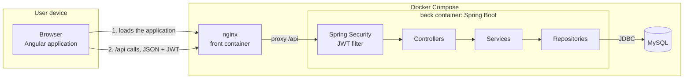

# Architecture

This document describes how the MDD code base is organised and the rules every change must follow.

## Overview



- The Angular application runs in the browser. nginx serves it and forwards every `/api` call to the back-end.
- The back-end exposes a JSON REST API secured by JWT.
- MySQL stores the data. Flyway creates and evolves the schema.

## Tech stack

| Area | Tools |
| --- | --- |
| Front-end | Angular 20, TypeScript 5.9, Angular CLI, RxJS, Signals, Tailwind CSS, Angular CDK (accessibility) |
| Back-end | Java 21, Spring Boot 3.5 (Web, Data JPA, Security, Validation), Lombok, Maven |
| Database | MySQL 8.4, Flyway |
| Security | JWT (Spring Security OAuth2 Resource Server), Argon2id password hashing |
| API documentation | springdoc-openapi (Swagger UI) |
| Tests | JUnit 5, Mockito, Spring Boot Test, Karma and Jasmine, Cypress |
| Code quality | ESLint, Prettier, SonarQube, JaCoCo (back-end coverage) |
| Infrastructure | Docker, Docker Compose, nginx |
| CI and project management | GitHub Actions, GitHub Projects |
| API testing | Postman |

## Code map

### Back-end (`back/`)

```
src/main/java/com/openclassrooms/mddapi/
├── config/        cross-cutting configuration (CORS, OpenAPI)
├── controller/    REST controllers: HTTP layer, input validation, DTOs in and out
├── dto/           request and response objects exchanged with the front-end
├── exception/     business exceptions and the global error handler
├── mapper/        entity ↔ DTO conversion (MapStruct)
├── model/         JPA entities
├── repository/    Spring Data JPA repositories
├── security/      Spring Security configuration and JWT handling
└── service/       business rules: interfaces, implementations in service/impl/

src/main/resources/
├── application.properties
└── db/
    ├── migration/     Flyway migrations, all environments
    └── dev-data/      demo data, loaded with the dev profile only
```

A request goes through: JWT filter → controller → service → repository → MySQL.

### Front-end (`front/`)

```
src/app/
├── core/        app-wide services, HTTP interceptor, route guards, models
├── features/    one folder per feature: auth, feed, topics, posts, profile
└── shared/      reusable UI components
```

## Architecture rules

- Controllers only return DTOs, never JPA entities.
- Business rules live in services, never in controllers.
- Every route requires a JWT, except `/api/auth/register` and `/api/auth/login`.
- The schema only changes through a new Flyway migration. A migration that has already run is never edited.
- Demo data is only loaded with the `dev` profile.
- Secrets come from environment variables, never from the code.
- Errors are handled in one place and never expose internal details.
