# UI/UX annex

How the Figma mockups and the functional specifications were turned into the screens of the MVP. The screenshots are generated from the running application by `npm run screenshots` (Cypress, demo account `alice`), so they always match the code.

## Design principles

- **Mockups first**: layout, wording and the primary color (`#7763c5`) come from the Figma mockups; Tailwind CSS 4 utilities reproduce them without custom CSS per component.
- **Mobile first**: every screen is built for a narrow screen, then widened from 768 px (`md:` breakpoint). The specifications require every screen to be responsive.
- **Few elements, always the same place**: the header carries the navigation on every logged-in page, the main action of each page sits at the top, and the forms share one layout (label, field, error message).
- **Accessible by default**: semantic HTML, keyboard navigation and sufficient contrast (see [Accessibility](ARCHITECTURE.md#accessibility)).

## Screen-by-screen analysis

### Home (visitor)

| Desktop | Mobile |
| --- | --- |
| 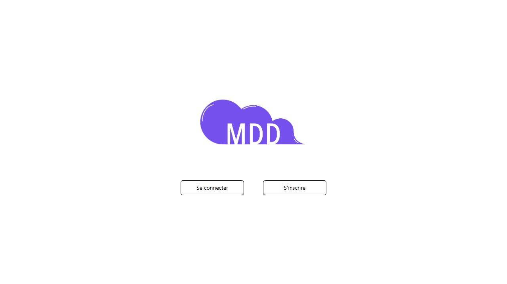 | 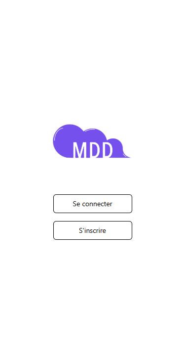 |

- Specification: access the login and registration forms from the home page.
- The logo and two buttons only: a visitor has nothing else to do. The buttons stand side by side on desktop and are stacked on mobile.
- A logged-in member never sees this page: they go straight to their feed.

### Registration and login

| Registration | Login (mobile) |
| --- | --- |
| 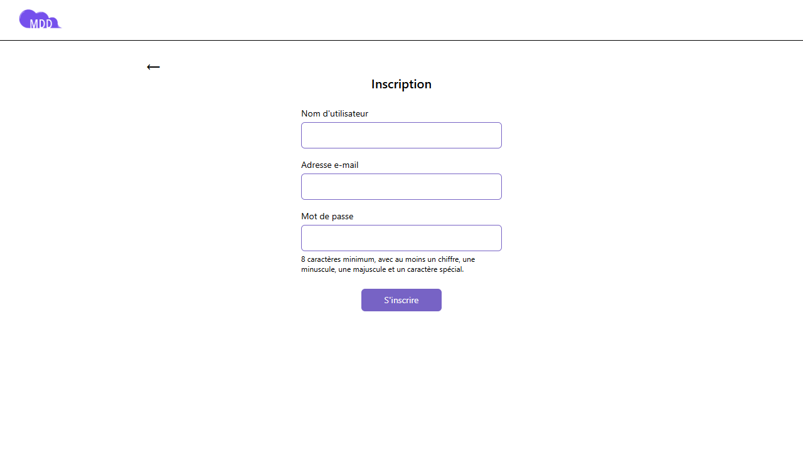 | 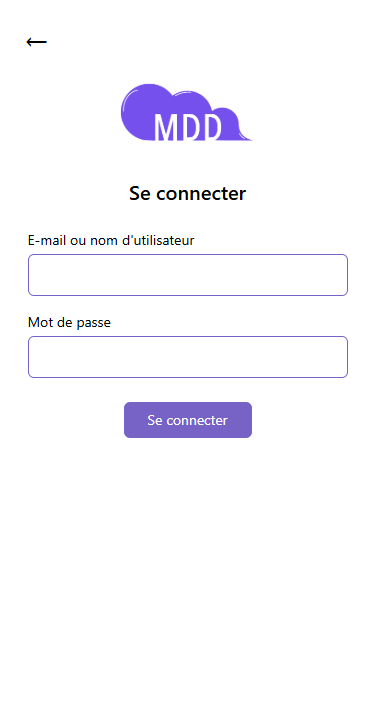 |

- Specifications: register with an email, a password and a username; log in with an email **or** a username.
- One field per line with a visible label; the password rules are written under the field before the user types, then turn red only if they are not met.
- A login failure shows one generic message, so that the form does not reveal which accounts exist.
- The back arrow returns to the home page; on mobile the header is replaced by the logo above the form, as in the mockup.

### News feed

| Desktop | Mobile |
| --- | --- |
| 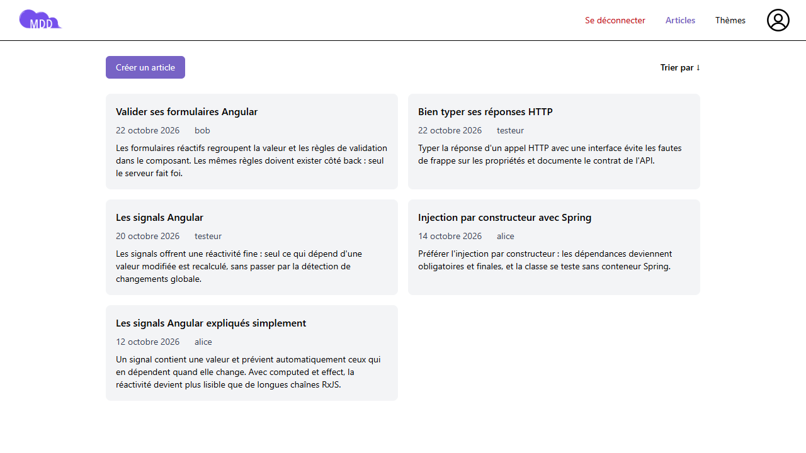 | 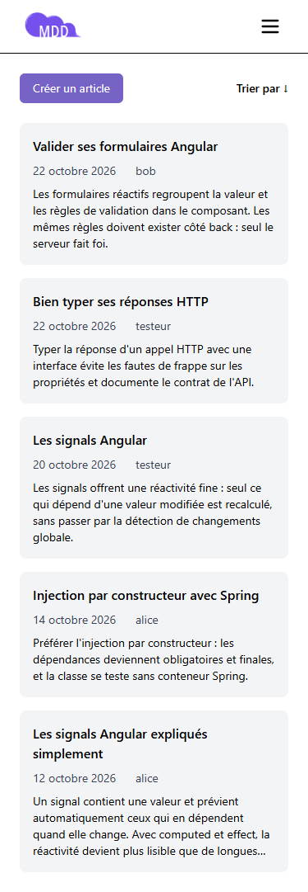 |

- Specifications: the feed shows the articles of the subscribed topics, newest first, and can be sorted both ways; a member adds an article from it.
- "Créer un article" and "Trier par" sit above the list, the two actions of the page. The arrow of the sort button shows the current order.
- Each article is a card (title, date, author, start of the content) that opens the article: two columns on desktop, one on mobile.
- An empty feed explains why and links to the topics page.

### Article and comments

| Desktop | Mobile |
| --- | --- |
| 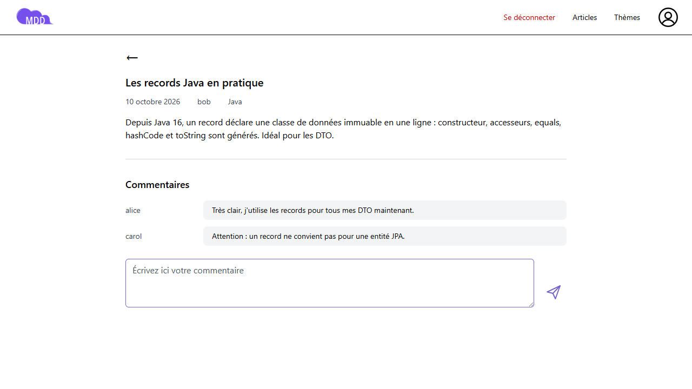 | 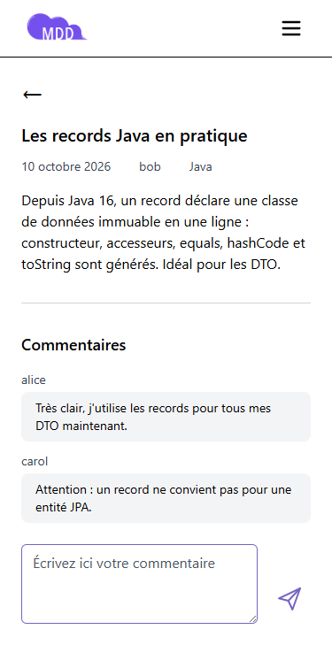 |

- Specifications: an article shows its topic, title, author, date, content and comments; a member can comment, without sub-comments.
- The comments are listed oldest first, like a conversation, with the comment form at the end of the list; a new comment appears without reloading the page.
- On desktop the author name sits beside each comment, on mobile above it.

### Create an article

| Desktop | Mobile |
| --- | --- |
| 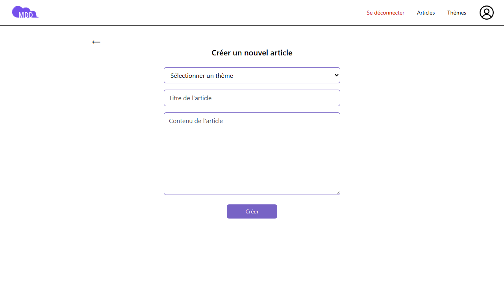 | 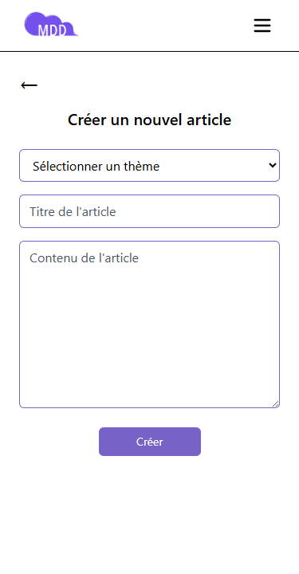 |

- Specification: choose the topic, then write the title and the content; the author and the date are set automatically.
- The fields follow the order of the specification; the "Créer" button stays disabled while a request is in progress, so that an article cannot be sent twice.

### Topics

| Desktop | Mobile |
| --- | --- |
| 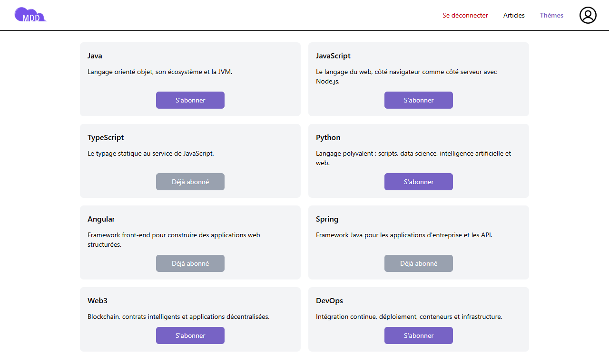 | 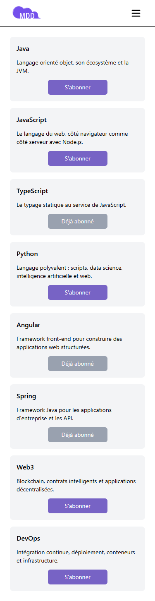 |

- Specifications: list every topic, subscribed or not; after a click on "S'abonner", the button becomes inactive and reads "Déjà abonné".
- The topic cards use the same component as the subscriptions of the profile page, with a different button.

### Profile

| Desktop | Mobile |
| --- | --- |
| 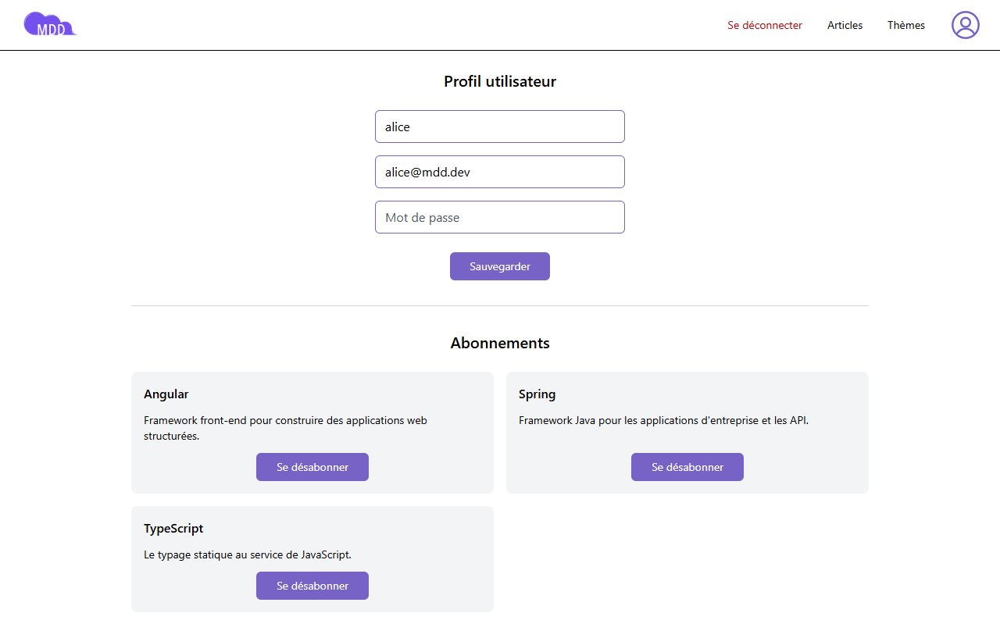 | 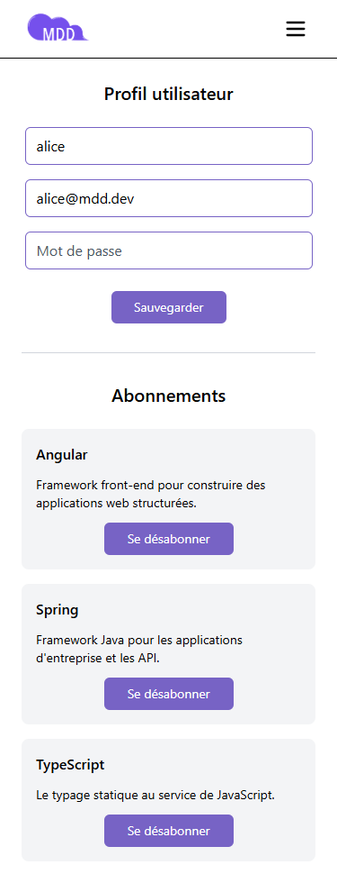 |

- Specifications: view and edit the email, username and password; unsubscribe from the profile page.
- As in the mockup, the fields show their value directly, with "Sauvegarder" below; an empty password field keeps the current password.
- The subscriptions are listed under the form, each with its "Se désabonner" button.

### Navigation on mobile and page not found

| Mobile menu | Page not found |
| --- | --- |
| 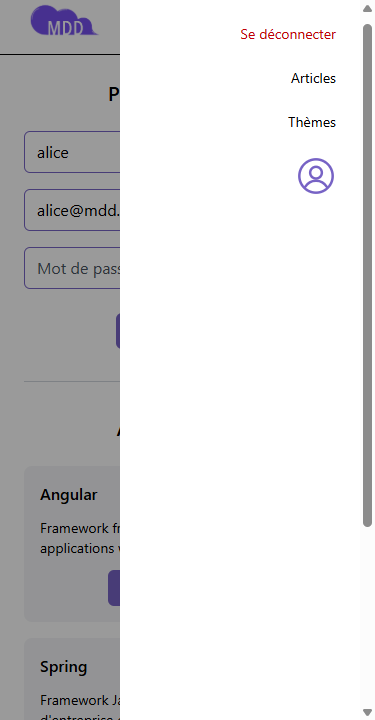 | 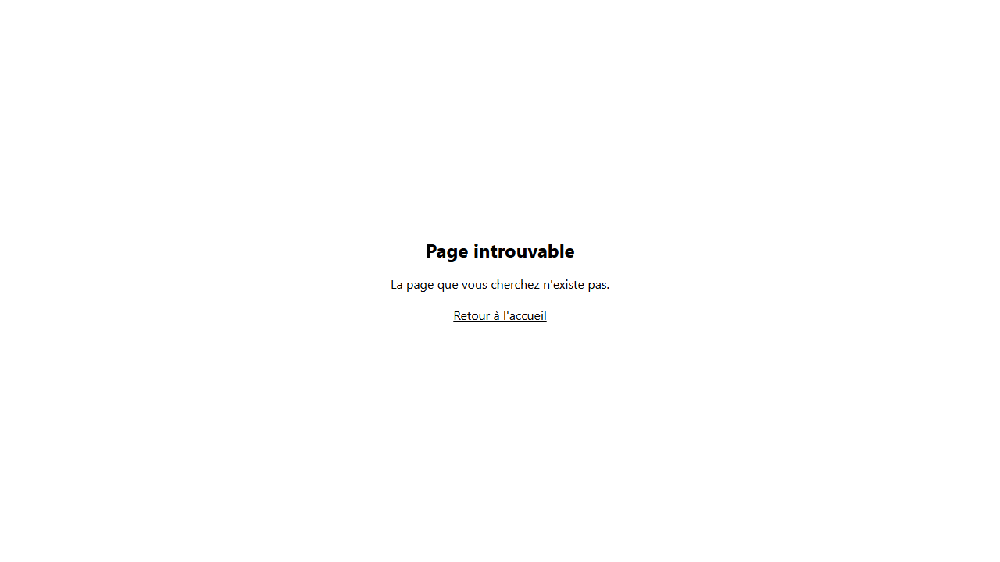 |

- On mobile, the links of the header move into a side menu opened by the burger button; Escape or a click outside closes it.
- An unknown address shows a page with a link back to the home page.

## Main user journeys

| Journey | Steps |
| --- | --- |
| Join the network | Home → S'inscrire → empty feed → Thèmes → S'abonner → feed with articles |
| Read and react | Feed → sort → open an article → comment |
| Publish | Feed → Créer un article → choose topic, title, content → back to the feed, article on top |
| Manage the account | Profile icon → edit username, email or password → Sauvegarder; Se désabonner from a topic |
| Leave and come back | Se déconnecter → home; log in again with the email or the username: the session lasts 7 days |

The end-to-end test `front/cypress/e2e/user-journey.cy.ts` follows most of these journeys: registration, subscription, publication, comment, unsubscription, logout and login.

## Responsive and accessibility choices

| Topic | Choice |
| --- | --- |
| Breakpoint | One breakpoint at 768 px: one column and a burger menu below, two columns and inline navigation above |
| Touch targets | Buttons and links are at least as tall as a line of text with padding, easy to tap on a phone |
| Keyboard | Every action is a native button or link; a skip link leads to the content; Escape closes the menu |
| Focus | A visible focus outline on every element |
| Labels and errors | Each field has a label; errors are written under the field and linked to it for screen readers |
| Contrast | At least 4.5:1 for text and placeholders, including white text on the primary color (4.8:1) |
| Result | Lighthouse accessibility score of 98 on the feed, article, topics and profile pages |
